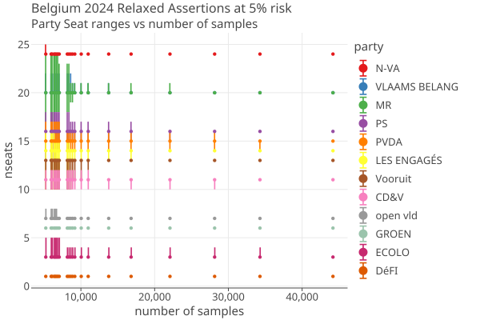
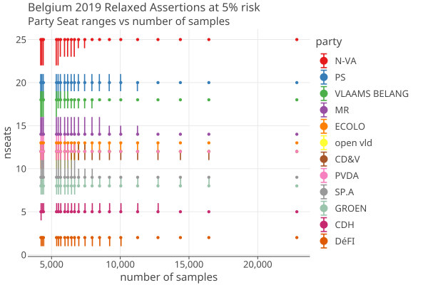

# Relaxed Assertions on Belgium Chambre des représentants Elections
10/25/2026

**Uniform Relaxation**. Across all contests (aka "Constituencies"), iteratively choose the assertion that has the most impact on the number of samples needed for the entire audit. Most-impact is calculated by finding the difference between an assertion's estimated MVRs (nmvrs) and the next highest assertion's nmvrs from the same contest. Once the largest-impact assertion is found, that contest's sample limit is set to the next highest assertion's nmvrs. Then all assertions for that contest with estimated nmvrs higher than the sample limit will fail. 

This algorithm does not try to minimimize the seat spread, does not try to control how many ballots any Constituency will need to sample, and has no bias about any party's results.

The plot shows, starting at the rightmost column which has no failing assertions, the effect of successively failing the next largest-impact assertion, as you move left across the plot. 

The plots below shows the range of seats as error bars, as well as the reported number of seats as points.

**Party Seat Ranges** are calculated from the latest draft of the paper [Ideas for bounding sample sizes for Belgian
RLAs](papers/DhondtRelaxedAssertions.1001.pdf). Each time another assertion is "failed", we run the complete _RelaxedAssertions_ algorithm to calculate bounds on all partys' winning seat count. 

The tables below shows the initial and final samples needed by each constituency after removing the first six most-impact assertions, which in both years brings
the total number of samples needed below 10,116 and 9,210 in 2024 and 2019 respectively.

Note that this is the "best case" scenario where no discrepencies are found between the sampled ballots and the CVRs. 
In the presence of discrepencies, the sample sizes will be higher.

## 2024

_(click on image to get interactive html graph)_

After 6 failures:

| contest        | initialSamples | relaxedSamples | failures |
|----------------|----------------|----------------|----------|
| Anvers         | 12016          | 2828           | 2        |
| Bruxelles      | 7811           | 1756           | 1        |
| FlandreWest    | 985            | 985            | 0        |
| FlandreEast    | 3567           | 787            | 1        |
| Limbourg       | 673            | 673            | 0        |
| Liège          | 5914           | 640            | 1        |
| BrabantWallon  | 622            | 622            | 0        |
| Luxembourg     | 574            | 574            | 0        |
| Hainaut        | 10449          | 549            | 1        |
| BrabantFlamant | 388            | 388            | 0        |
| Namur          | 314            | 314            | 0        |
| Total          | 43313          | 10116          | 6        |

After each step:

| contest        | step 0 | step 1 | step 2 | step 3 | step 4 | step 5 | step 6 | step 7 | step 8 | step 9 | step 10 | step 11 | step 12 | step 13 | step 14 | step 15 | step 16 | step 17 | step 18 | step 19 | step 20 |
|----------------|--------|--------|--------|--------|--------|--------|--------|--------|--------|--------|---------|---------|---------|---------|---------|---------|---------|---------|---------|---------|---------|
| Anvers         | 12016  | 12016  | * 5866 | 5866   | 5866   | * 2828 | 2828   | * 1883 | 1883   | 1883   | 1883    | 1883    | 1883    | 1883    | 1883    | 1883    | 1883    | 1883    | 1883    | * 1745  | * 1021  |
| BrabantFlamant | 388    | 388    | 388    | 388    | 388    | 388    | 388    | 388    | 388    | 388    | 388     | 388     | 388     | 388     | 388     | 388     | 388     | 388     | 388     | 388     | 388     |
| BrabantWallon  | 622    | 622    | 622    | 622    | 622    | 622    | 622    | 622    | 622    | 622    | 622     | 622     | 622     | 622     | 622     | 622     | 622     | * 465   | * 206   | 206     | 206     |
| Bruxelles      | 7811   | 7811   | 7811   | * 1756 | 1756   | 1756   | 1756   | 1756   | 1756   | 1756   | 1756    | 1756    | * 1526  | * 430   | 430     | 430     | 430     | 430     | 430     | 430     | 430     |
| FlandreEast    | 3567   | 3567   | 3567   | 3567   | 3567   | 3567   | * 787  | 787    | 787    | 787    | 787     | 787     | 787     | 787     | 787     | * 608   | 608     | 608     | 608     | 608     | 608     |
| FlandreWest    | 985    | 985    | 985    | 985    | 985    | 985    | 985    | 985    | 985    | 985    | 985     | 985     | 985     | 985     | 985     | 985     | 985     | 985     | 985     | 985     | 985     |
| Hainaut        | 10449  | * 549  | 549    | 549    | 549    | 549    | 549    | 549    | 549    | 549    | 549     | * 307   | 307     | 307     | 307     | 307     | 307     | 307     | 307     | 307     | 307     |
| Limbourg       | 1544   | 1544   | 1544   | 1544   | 1544   | 1544   | 1544   | 1544   | * 673  | 673    | * 428   | 428     | 428     | 428     | 428     | 428     | 428     | 428     | 428     | 428     | 428     |
| Liège          | 5914   | 5914   | 5914   | 5914   | * 640  | 640    | 640    | 640    | 640    | * 340  | 340     | 340     | 340     | 340     | 340     | 340     | 340     | 340     | 340     | 340     | 340     |
| Luxembourg     | 574    | 574    | 574    | 574    | 574    | 574    | 574    | 574    | 574    | 574    | 574     | 574     | 574     | 574     | * 377   | 377     | * 208   | 208     | 208     | 208     | 208     |
| Namur          | 314    | 314    | 314    | 314    | 314    | 314    | 314    | 314    | 314    | 314    | 314     | 314     | 314     | 314     | 314     | 314     | 314     | 314     | 314     | 314     | 314     |
| Total          | 44184  | 34284  | 28134  | 22079  | 16805  | 13767  | 10987  | 10042  | 9171   | 8871   | 8626    | 8384    | 8154    | 7058    | 6861    | 6682    | 6513    | 6356    | 6097    | 5959    | 5235    |

## 2019

After 6 failures:

| contest        | initialSamples | relaxedSamples | failures |
|----------------|----------------|----------------|----------|
| Anvers         | 8227           | 1826           | 1        |
| Hainaut        | 3393           | 1762           | 1        |
| FlandreEast    | 1377           | 1377           | 0        |
| FlandreWest    | 962            | 962            | 0        |
| Liège          | 2283           | 802            | 1        |
| BrabantFlamant | 1517           | 690            | 1        |
| Limbourg       | 674            | 674            | 0        |
| Bruxelles      | 1733           | 508            | 1        |
| Namur          | 2357           | 286            | 1        |
| Luxembourg     | 169            | 169            | 0        |
| BrabantWallon  | 154            | 154            | 0        |
| Total          | 22846          | 9210           | 6        |

After each step:

| contest        | step 0 | step 1 | step 2 | step 3 | step 4 | step 5 | step 6 | step 7 | step 8 | step 9 | step 10 | step 11 | step 12 | step 13 | step 14 | step 15 | step 16 | step 17 | step 18 | step 19 | step 20 |
|----------------|--------|--------|--------|--------|--------|--------|--------|--------|--------|--------|---------|---------|---------|---------|---------|---------|---------|---------|---------|---------|---------|
| Anvers         | 8227   | * 1826 | 1826   | 1826   | 1826   | 1826   | 1826   | 1826   | 1826   | 1826   | 1826    | 1826    | 1826    | 1826    | 1826    | 1826    | 1826    | * 1692  | * 744   | * 646   | 646     |
| BrabantFlamant | 1517   | 1517   | 1517   | 1517   | 1517   | 1517   | * 690  | 690    | 690    | 690    | 690     | * 394   | 394     | 394     | 394     | 394     | 394     | 394     | 394     | 394     | 394     |
| BrabantWallon  | 154    | 154    | 154    | 154    | 154    | 154    | 154    | 154    | 154    | 154    | 154     | 154     | 154     | 154     | 154     | 154     | 154     | 154     | 154     | 154     | 154     |
| Bruxelles      | 1733   | 1733   | 1733   | 1733   | 1733   | * 508  | 508    | 508    | 508    | 508    | 508     | 508     | 508     | 508     | 508     | 508     | 508     | 508     | 508     | 508     | * 420   |
| FlandreEast    | 1377   | 1377   | 1377   | 1377   | 1377   | 1377   | 1377   | 1377   | 1377   | * 847  | 847     | 847     | * 619   | * 365   | 365     | 365     | 365     | 365     | 365     | 365     | 365     |
| FlandreWest    | 962    | 962    | 962    | 962    | 962    | 962    | 962    | 962    | * 418  | 418    | 418     | 418     | 418     | 418     | 418     | 418     | * 254   | 254     | 254     | 254     | 254     |
| Hainaut        | 3393   | 3393   | 3393   | * 1762 | 1762   | 1762   | 1762   | * 1046 | 1046   | 1046   | 1046    | 1046    | 1046    | 1046    | * 820   | * 515   | 515     | 515     | 515     | 515     | 515     |
| Limbourg       | 674    | 674    | 674    | 674    | 674    | 674    | 674    | 674    | 674    | 674    | 674     | 674     | 674     | 674     | 674     | 674     | 674     | 674     | 674     | 674     | 674     |
| Liège          | 2283   | 2283   | 2283   | 2283   | * 802  | 802    | 802    | 802    | 802    | 802    | * 347   | 347     | 347     | 347     | 347     | 347     | 347     | 347     | 347     | 347     | 347     |
| Luxembourg     | 169    | 169    | 169    | 169    | 169    | 169    | 169    | 169    | 169    | 169    | 169     | 169     | 169     | 169     | 169     | 169     | 169     | 169     | 169     | 169     | 169     |
| Namur          | 2357   | 2357   | * 286  | 286    | 286    | 286    | 286    | 286    | 286    | 286    | 286     | 286     | 286     | 286     | 286     | 286     | 286     | 286     | 286     | 286     | 286     |
| Total          | 22846  | 16445  | 14374  | 12743  | 11262  | 10037  | 9210   | 8494   | 7950   | 7420   | 6965    | 6669    | 6441    | 6187    | 5961    | 5656    | 5492    | 5358    | 4410    | 4312    | 4224    |
